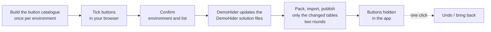

# DemoHider

**Hide command bar buttons in Dynamics 365 / model-driven apps in bulk, and bring them back with one click.**

Made for demos. Tick the buttons you don't want a customer to see, confirm, and DemoHider hides them
on every table you chose, in a supported way, with a full undo.


---

## What it does

- **Tick boxes in your browser.** Every button on every table you choose, grouped by
  *Main grid*, *Form* and *Subgrid*, with quick-select groups such as Reports, Templates and Flows.
- **Check before anything changes.** A confirmation page shows the environment URL and every change.
- **Live progress, and fast.** It imports only the tables you changed, then publishes them.
  You can watch each step.
- **Safe undo.** Every change is backed up. *Undo this change*, or bring back everything after the demo.
- **Reusable.** Save a set of buttons and use it again in another environment or tenant.
- **Only touches its own changes.** It never removes hides made by anyone else.

## How it works



Behind the scenes DemoHider adds standard `HideCustomAction` entries to the ribbon (RibbonDiffXml) of
each table in an unmanaged solution called **DemoHider**. That is the same supported mechanism tools
like Ribbon Workbench use.

## See it

| 1. Confirm | 2. Watch the progress | 3. Done, with undo |
|---|---|---|
|  |  |  |

## Get started

New to this? Follow the **[step-by-step guide](docs/GUIDE.md)**. It assumes no prior experience and
takes about an hour the first time.

In short:

1. **Install** VS Code, Python 3.10+, Power Platform Tools (`pac`) and the Azure CLI. → [Guide §3](docs/GUIDE.md#3-one-time-setup-on-your-computer)
2. **Download** this repository (green **Code** button → **Download ZIP**) and unzip it to `C:\DemoHider`.
3. **Sign in** to your environment:
   ```powershell
   pac auth create --name MyEnv --environment https://yourorg.crm.dynamics.com
   az login --tenant yourtenant.onmicrosoft.com --allow-no-subscriptions
   ```
   → [Guide §4](docs/GUIDE.md#4-connect-to-an-environment)
4. **Build the button catalogue:**
   ```powershell
   python scripts\build_catalog.py --env-url https://yourorg.crm.dynamics.com --env-name MyEnv
   ```
   → [Guide §5](docs/GUIDE.md#5-build-the-button-catalogue)
5. **Create a small solution called DemoHider** with your tables (no other components), then export and unpack it. → [Guide §6](docs/GUIDE.md#6-create-the-demohider-solution)
6. **Hide buttons:**
   ```powershell
   powershell -ExecutionPolicy Bypass -File .\demohider.ps1 -EnvName MyEnv -Pick
   ```
   Tick, click **Apply**, check the URL, then click **Confirm and send**. → [Guide §7](docs/GUIDE.md#7-hide-and-unhide-with-tick-boxes-easiest)

After the demo, bring everything back:

```powershell
powershell -ExecutionPolicy Bypass -File .\demohider.ps1 -EnvName MyEnv -UnhideAll
```

> **Fast by design:** each change imports only the tables it touches. Add tables to the DemoHider
> solution *without* their columns, forms and views, and a change takes just a few minutes.
> → [Guide §6.4](docs/GUIDE.md#64-keep-the-solution-small-faster-sending)

## Documentation

| Page | What's in it |
|---|---|
| **[Step-by-step guide](docs/GUIDE.md)** | Setup, first run, presets, other environments, troubleshooting |
| [Quick reference](docs/QUICK-REFERENCE.md) | One page of everyday commands |
| [Limitations](docs/LIMITATIONS.md) | What DemoHider can't do. Read this before using it with a customer |
| [License](LICENSE) | MIT |

## Before you use it

- **Classic ribbon buttons only.** Modern commands built in the command designer, the site map and the
  app header are not covered.
- **Per table, for everyone, in every app** of the environment. Not per app, user or security role.
- **Hiding is not security.** Use security roles for anything that must really be blocked.
- **Windows** with Python, `pac` and the Azure CLI. System Administrator or System Customizer role.
- Meant for **demo, trial and development environments**.

Full list: [docs/LIMITATIONS.md](docs/LIMITATIONS.md).

## What's in this repository

```
demohider.ps1          the command you run
scripts\
  build_catalog.py     reads every button from your environment
  picker_server.py     the tick-box page
  flow_server.py       the confirmation and progress page
  sender.py            updates files, packs, imports and publishes
  partial_solution.py  makes the trimmed copy with only the changed tables
  hide_engine.py       writes the hides, with backups and undo
  make_plan.py         presets, Find, and the Excel picker
  publish_tables.py    publishes only the changed tables
presets\
  sales-demo.json      an example preset
docs\                  guide, quick reference, limitations, images
```

Folders such as `catalog`, `solutions`, `runs` and `manifests` are created on your computer as you go.
They are not part of the repository.

## License and disclaimer

Released under the [MIT License](LICENSE). It is provided **as is**, without warranty.

DemoHider is an independent project and is **not affiliated with, endorsed by, or supported by
Microsoft**. Microsoft, Dynamics 365, Power Apps, Power Platform and Dataverse are trademarks of the
Microsoft group of companies.
