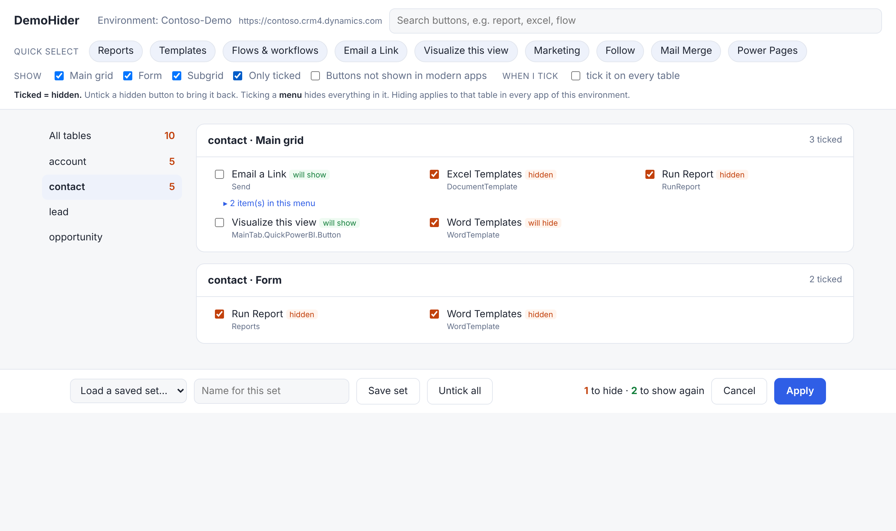
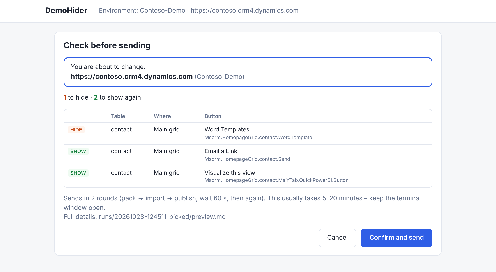
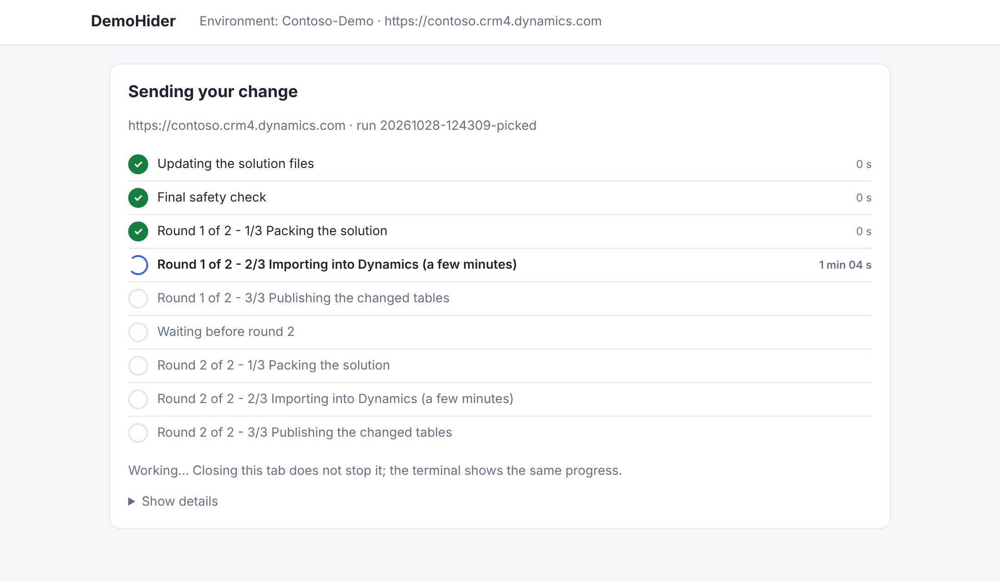
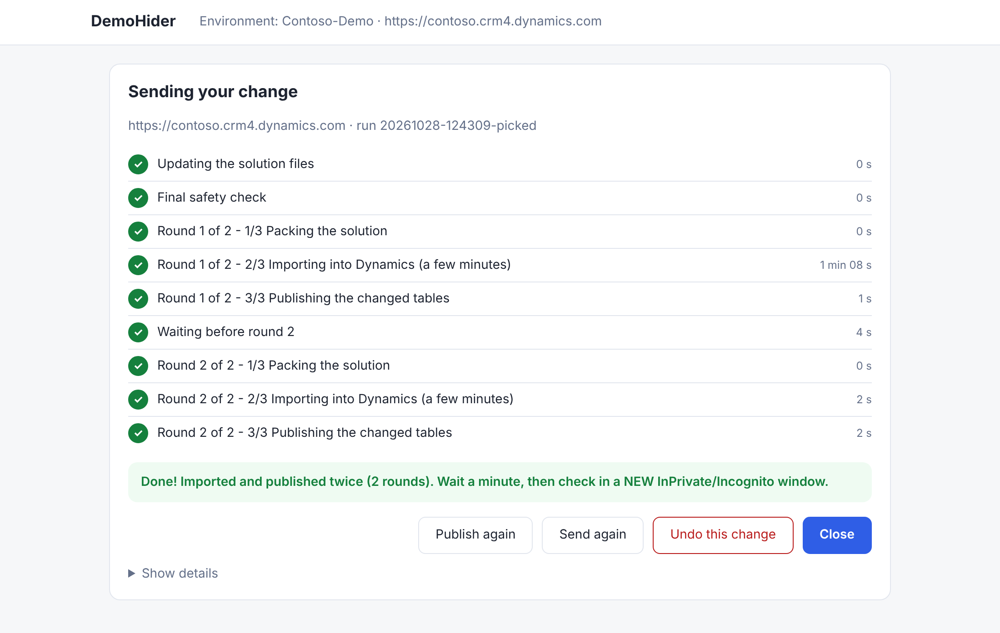

# DemoHider – Step-by-step guide

Hide buttons from the command bars of Dynamics 365 / model-driven apps **in bulk**,
across several tables at once, and bring them back with one click.

Built for demos: make the app show only the buttons that fit a customer's process.

> New here? The [README](../README.md) has a two-minute overview with pictures.
> This guide takes you from nothing to your first hidden button. Allow about an hour the first time.

---

## Contents

1. [How it works (2-minute overview)](#1-how-it-works)
2. [What you need](#2-what-you-need)
3. [One-time setup on your computer](#3-one-time-setup-on-your-computer)
4. [Connect to an environment (sign in)](#4-connect-to-an-environment)
5. [Build the button catalogue](#5-build-the-button-catalogue)
6. [Create the DemoHider solution](#6-create-the-demohider-solution)
7. [**Hide and unhide with tick boxes (easiest)**](#7-hide-and-unhide-with-tick-boxes-easiest)
8. [Write a preset (optional – reusable rules)](#8-write-a-preset-optional)
9. [Hide buttons with a preset](#9-hide-buttons-with-a-preset)
10. [Bring buttons back (unhide)](#10-bring-buttons-back)
11. [Working with another environment or tenant](#11-another-environment-or-tenant)
12. [Troubleshooting](#12-troubleshooting)
13. [Command cheat sheet](#13-command-cheat-sheet)
14. [Limitations](#14-limitations)
15. [License and disclaimer](#15-license-and-disclaimer)

---

## 1. How it works

Dynamics stores every command bar as XML (the "ribbon"). To hide a button you add
one line to it that says *"hide this button"*. DemoHider writes those lines for you.

```
 1. CATALOGUE     A list of every button in your environment, with exact IDs
                  (built once per environment)
 2. CHOOSE        Tick the buttons to hide on a page in your browser
                  (or, optionally, write a reusable "preset" file)
 3. CONFIRM       DemoHider checks everything and shows the list and the
                  environment URL in your browser - click "Confirm and send"
 4. SEND          It updates a solution called "DemoHider", imports and
                  publishes it (twice), and shows the progress on the page
 5. RESULT        Press Ctrl+F5 in the app - the buttons are gone
 6. UNDO          One click (or one command) brings them back
```

**Good to know**

- Nothing changes until you click **Confirm and send**.
- Every change is backed up and can be undone.
- DemoHider only ever removes hides **it** created – never anyone else's customizations.
- A button hidden on a table is hidden in **every app** that uses that table in that environment.
- Hiding is **not security** – a user could still reach the action another way.
  Use security roles for anything that must truly be blocked.
- Use it in **demo / dev environments**, not in a customer's production.

---

## 2. What you need

| Item | Notes |
|---|---|
| Windows PC | The commands below are for Windows PowerShell |
| A Dynamics 365 / Power Apps environment | e.g. a Sales trial or sandbox |
| Security role **System Administrator** or **System Customizer** | in that environment |
| The DemoHider files | downloaded from GitHub (section 3.3) |
| About 1 hour | for the one-time setup |

---

## 3. One-time setup on your computer

### 3.1 Install four tools

Install each with the default options.

| Tool | Where to get it | Important |
|---|---|---|
| **Visual Studio Code** | code.visualstudio.com | Your editor and terminal |
| **Python 3.10 or newer** | python.org → Downloads | On the first install screen **tick "Add Python to PATH"** |
| **Power Platform Tools** (gives you `pac`) | In VS Code: Extensions (Ctrl+Shift+X) → search **Power Platform Tools** → Install | |
| **Azure CLI** (gives you `az`) | Search "Install Azure CLI Windows" → Microsoft's MSI installer | Free. Used only to sign in – **no Azure subscription or cost** |

### 3.2 Check the tools

Close and reopen VS Code, open a terminal (**Ctrl+`**), and run:

```powershell
python --version
pac
az --version
```

Each should print a version or help text. If you see *"is not recognized"*,
restart your computer and try again; if it still fails, reinstall that tool.

### 3.3 Download DemoHider

1. Open the DemoHider page on GitHub.
2. Click the green **Code** button → **Download ZIP**.
3. Right-click the downloaded ZIP → **Extract All…** → choose a short folder, for example `C:\`.
4. Rename the extracted folder (e.g. `BulkHideButtonsAI-main`) to **`DemoHider`**, so you end up with `C:\DemoHider`.

> Using Git? `git clone <repository URL> C:\DemoHider` does the same.

The folder should look like this:

```
DemoHider\
  demohider.ps1          <- the command you run
  README.md              <- overview
  LICENSE
  docs\
    GUIDE.md             <- this guide
    QUICK-REFERENCE.md   <- one-page command summary
    LIMITATIONS.md       <- what DemoHider cannot do
    images\
  scripts\
    build_catalog.py
    make_plan.py
    picker_server.py     <- the tick-box page
    flow_server.py       <- the confirmation and progress page
    sender.py            <- update files, pack, import, publish (two rounds)
    partial_solution.py  <- trimmed copy with only the changed tables (faster)
    hide_engine.py
    publish_tables.py
  presets\
    sales-demo.json      <- an example preset
```

The folders `catalog`, `solutions`, `plans`, `runs` and `manifests` are created as you go.

In VS Code: **File → Open Folder → DemoHider**. Then open a terminal (**Ctrl+`**).
**Run every command in this guide from that terminal.** The prompt should end in `\DemoHider>`.

### 3.4 About running the script

Windows blocks downloaded scripts by default. So every DemoHider command in this guide starts with:

```powershell
powershell -ExecutionPolicy Bypass -File .\demohider.ps1
```

This allows the script **for that one run only**. It does not change your computer's settings.

---

## 4. Connect to an environment

### 4.1 Find your details

You need three values. Write them down – you will use them in several commands.

| Placeholder | What it is | Example | Where to find it |
|---|---|---|---|
| `<EnvURL>` | Environment URL | `https://contoso.crm4.dynamics.com` | Open your app; copy the start of the browser address up to `.com` |
| `<Tenant>` | Your organisation's domain | `contoso.onmicrosoft.com` or `contoso.com` | The part after `@` in your work email usually works |
| `<EnvName>` | A short nickname **you** choose | `CUS-Dev` | Letters, numbers and dashes, no spaces |

> In all commands below, replace the `<...>` placeholders **including the `< >`**.
> Example: `--env-name <EnvName>` becomes `--env-name CUS-Dev`.

### 4.2 Sign in (two sign-ins, both open a browser window)

```powershell
pac auth create --name <EnvName> --environment <EnvURL>
az login --tenant <Tenant> --allow-no-subscriptions
```

Example:

```powershell
pac auth create --name CUS-Dev --environment https://contoso.crm4.dynamics.com
az login --tenant contoso.onmicrosoft.com --allow-no-subscriptions
```

`--allow-no-subscriptions` is needed because demo tenants normally have no Azure subscription.

### 4.3 Check the sign-in

```powershell
pac org who
az account get-access-token --resource <EnvURL> --query expiresOn
```

- The first shows your environment and user name.
- The second shows a date and time. ✅ You're connected.

> **Sign-ins expire** after about an hour of inactivity. If a later command says it could not
> get a token, just run the `az login ...` line again.

---

## 5. Build the button catalogue

The catalogue is a list of every button on the tables you choose, with their exact IDs.
Build it **once per environment**, and again after installing new apps or solutions.

### 5.1 Run it

```powershell
python scripts\build_catalog.py --env-url <EnvURL> --env-name <EnvName>
```

This reads **Account, Contact, Lead, Opportunity** plus the global buttons. It takes 1–5 minutes.

To choose your own tables, add `--tables` with the tables' **logical names**, separated by commas, no spaces:

```powershell
python scripts\build_catalog.py --env-url <EnvURL> --env-name <EnvName> --tables account,contact,lead,opportunity,quote,salesorder,incident
```

> **Logical names** are the internal names: Order = `salesorder`, Case = `incident`,
> custom tables include a prefix such as `cr4a1_project`.
> Find them in make.powerapps.com → **Tables** → open the table → **Properties**.

Running it again with more tables **adds** them; the existing ones are kept.

### 5.2 What success looks like

```
  Reading account ... 343 buttons
  Reading contact ... 364 buttons
  ...
Table-level buttons: 1361   Application-level buttons: 569
```

The files are saved in `catalog\<EnvName>\`. You never need to edit them.

### 5.3 If a table fails

```powershell
python scripts\build_catalog.py --env-url <EnvURL> --env-name <EnvName> --retry-failed
```

This retries **only** the tables that failed. If it timed out again, add `--split`
to fetch that table in smaller parts.

### 5.4 Refresh the catalogue after updating DemoHider (no download)

When you get a newer version of DemoHider, re-read the ribbon files you already downloaded
so the catalogue picks up new information (such as which buttons are never shown in modern apps):

```powershell
python scripts\build_catalog.py --env-url <EnvURL> --env-name <EnvName> --reparse
```

This takes seconds and does not contact Dynamics.

---

## 6. Create the DemoHider solution

DemoHider puts its hides into a small solution called **DemoHider**. You create it once per environment.

### 6.1 Create it in the browser

1. Go to **make.powerapps.com** and pick your environment (top right).
2. **Solutions → New solution**
   - Display name: `DemoHider`  (the name field fills in as `DemoHider`)
   - Publisher: choose **your own publisher** (not "Default Publisher")
   - **Create**
3. Open the solution → **Add existing → Table** → tick **every table you want to hide buttons on**
   (e.g. Account, Contact, Lead, Opportunity) → **Next**.
4. On the next screen **do not select any components** and leave
   *Include all objects* and *Include table metadata* **unticked** → **Add**.

The solution stays tiny, so imports are fast. **This matters a lot for speed** – see 6.4.

### 6.2 Download it to your computer (export + unpack)

```powershell
pac solution export --name DemoHider --path solutions\DemoHider.zip
pac solution unpack --zipfile solutions\DemoHider.zip --folder solutions\DemoHider --packagetype Unmanaged
```

**Check:** the folder `solutions\DemoHider\Entities` now contains one folder per table.

### 6.3 Adding tables later

1. Add the table to the DemoHider solution in the browser (same as 6.1 step 3–4).
2. Delete (or rename) the folder `solutions\DemoHider` on your computer.
3. Run the two commands from 6.2 again.
4. Make sure the table is also in the catalogue (5.1 with `--tables`).

> Do **not** delete the `manifests` or `runs` folders – they remember what is hidden.

### 6.4 Keep the solution small (faster sending)

**DemoHider only sends the tables a change touches.** For each run it makes a trimmed copy of the
solution, with just those tables, and packs and imports that copy, twice (section 9.2). Everything else
in the solution (other tables, business rules, flows, …) is left out of the import and stays as it is in
Dynamics. So hiding a button on Contact only imports Contact.

The progress page shows which tables are being sent, e.g. *Round 1 of 2 – 1/3 Packing the solution · Contact*.

What is left that affects speed is **what is inside the tables you change**:

| How the table was added to the DemoHider solution | Typical time for one change |
|---|---|
| **Without** columns, forms, views or table metadata (6.1 step 4) | a few minutes |
| With all its objects (every column, form and view) | noticeably longer – Dynamics re-imports all of it |

> If the trimmed copy can't be made or packed, DemoHider automatically sends the whole solution
> instead (the log says so). To always send the whole solution, add **`-FullSolution`** to the command.

**Check yours** (worth doing once – it makes every change on that table faster)

- In make.powerapps.com, open the **DemoHider** solution. The list should contain **only tables**.
  Business rules, flows, forms, views, columns, apps and so on should **not** be listed.
- On your computer, open `solutions\DemoHider`. A lean solution has, per table, a `RibbonDiff.xml`
  and not much else. Folders such as `FormXml`, `SavedQueries` or a top-level `Workflows` folder mean
  extra components are included.

**Slim it down** (no data or customizations are lost – *Remove* only takes things out of this solution):

1. Open the DemoHider solution in make.powerapps.com.
2. Select everything that is **not a table** (e.g. business rules) → **Remove → Remove from this solution**.
   Do **not** choose *Delete* – that would delete the item from the environment.
3. If a table was added with all its objects: select the table → **Remove → Remove from this solution**,
   then add it back with **Add existing → Table**, with *Include all objects* and
   *Include table metadata* **unticked** (6.1 steps 3–4). Your hidden buttons stay hidden – they live
   in Dynamics, and the next export brings them back into the files.
4. Download it again: delete the `solutions\DemoHider` folder and run the two commands from 6.2.
5. Run `-Pick` once to check that the buttons you hid are still shown as **hidden**.

**More ways to save time**

- Once your solution is lean, try one change with **`-OneRound`** (one pack → import → publish instead of
  two). If the buttons disappear within a few minutes, you can keep using it – it halves the time.
- Imports are slower when the environment is busy; early mornings are often quicker.

---

## 7. Hide and unhide with tick boxes (easiest)

This is the everyday way to use DemoHider: a page opens in your browser, you tick
the buttons you want hidden, and click **Apply**. **Ticked = hidden.**

### 7.1 Open the page

```powershell
powershell -ExecutionPolicy Bypass -File .\demohider.ps1 -EnvName <EnvName> -Pick
```

Your browser opens the DemoHider page. If it doesn't, copy the link the terminal shows
(it starts with `http://127.0.0.1:`) into your browser.

> The page runs only on your own computer. Leave the terminal open while you use it.

### 7.2 The page

| Part of the page | What it does |
|---|---|
| **Tables** (left) | Pick one table, or **All tables** |
| **Sections** | Each table is split into **Main grid** (the main list of records), **Form** (inside a record) and **Subgrid** (a list shown inside a form) |
| **Search** (top) | Type part of a button's name, e.g. `report`, `excel`, `flow` |
| **Quick select** | One click ticks a whole group – Reports, Templates, Flows & workflows, Email a Link, Visualize this view, Marketing, Follow, Mail Merge, Power Pages – on the tables and places shown |
| **Show** | Untick Main grid / Form / Subgrid to hide those sections. **Only ticked** shows just your choices. **Buttons not shown in modern apps** also lists buttons whose rules mean they never appear in model-driven apps (e.g. Run Workflow, Mail Merge) – hidden from the list by default because hiding them changes nothing |
| **tick it on every table** | When switched on, ticking a button ticks the same button on every table (same place) |
| **▸ items in this menu** | Some buttons are menus. Ticking the menu hides everything in it |
| Labels | **will hide** = hidden when you apply · **hidden** = already hidden · **will show** = comes back when you apply · **hidden with its menu** = inside a ticked menu (no separate action) · **not in modern apps** = never shown on screen anyway |
| Header | The environment name **and URL** – check it is the one you mean |
| Bottom bar | The counter shows how many buttons will be hidden / shown. **Apply** checks your choice and asks you to confirm (section 7.4) |

Each button shows its name and, underneath in grey, its short internal name.



*Above: with **Only ticked** switched on. Red ticks are hidden buttons; **will hide** / **will show** mark what changes when you click Apply.*

### 7.3 Example: hide reports and flows on all four tables

1. Click **All tables** on the left.
2. Click **Reports** and **Flows & workflows** under *Quick select*.
3. Tick anything else you want gone (use the search box to find it).
4. Click **Apply**. The same tab checks your choice and shows the **confirmation page** (7.4).
5. Check the URL in the blue box, then click **Confirm and send**.
6. Watch the progress until it says **Done!** (usually 5–20 minutes). Then wait a minute and check in a
   **new** InPrivate/Incognito window.

### 7.4 Confirm and watch the progress

After **Apply** (and for every other command – presets, `-Undo`, `-UnhideAll`, `-Publish`, `-Send`)
the browser shows:

**1. The confirmation page**



- **You are about to change:** the environment URL and name. Make sure it is the one you mean.
- The counts (*to hide* / *to show again*) and every button, with its table and place
  (Main grid / Form / Subgrid).
- **Cancel** = nothing is changed. **Confirm and send** = go ahead.
- If any button is **BLOCKED**, the reason is shown in red, nothing is changed and there is
  only a **Close** button.

**2. The progress page** – each step gets a tick when it finishes, with how long it took:



**Show details** opens the full output (the same as in the terminal). Closing the tab does **not**
stop the sending – the terminal keeps going and shows the same progress.

**3. The result**, in green (**Done!**), yellow (round 2 did not finish – round 1 was sent) or red
(**NOT LIVE YET**), with these buttons:



| Button | What it does |
|---|---|
| **Publish again** | Publishes this run's tables again – try this first if the change doesn't show |
| **Send again** | Packs, imports and publishes this run again (two rounds) |
| **Undo this change** | Puts the buttons back to how they were before this run and sends that (asks first) |
| **Close** | Ends DemoHider. The terminal shows the final result |

> Prefer the old way, typing **Y/N** in the terminal? Add **`-NoBrowser`** to any command.

### 7.5 Bring buttons back

Run the same command again. Buttons DemoHider has hidden are **already ticked**.

- **Untick** the ones you want back → **Apply** → **Confirm and send**.
- To bring back everything: click **Untick all** → **Apply** → **Confirm and send**
  (or use `-UnhideAll`, section 10).

You can hide some buttons and bring others back in the same go.

### 7.6 Save your choice for the next demo

1. Tick the buttons.
2. Type a name in **Name for this set** (letters, numbers, `-` or `_`, no spaces), e.g. `customer-abc`.
3. Click **Save set**. It is saved in the `presets` folder.

Next time, choose it in **Load a saved set…** – its buttons are ticked for you. Saved sets also
work in other environments, and with `-Preset` (section 9).

### 7.7 Notes

- **Environment check:** before changing anything, DemoHider compares the environment `pac` is
  signed in to with the catalogue's environment. If they differ it stops – see section 11 to switch.
- **Menus:** ticking a menu hides everything in it. Its items show *hidden with its menu* and get no
  action of their own, so a menu can never be hidden and its items restored at the same time.
- **What can be restored:** only hides DemoHider made, read from the solution files themselves.
  Hides made by anyone else are never shown as restorable and are never touched.
- The page lists the buttons that exist on each table – including some your users only see in certain
  situations (e.g. after selecting a record). Hiding those is harmless.
- **Cancel** (on the tick-box page or the confirmation page) changes nothing.
- If you change your mind after Apply, click **Cancel** on the confirmation page – nothing is changed.

---

## 8. Write a preset (optional)

> **You don't need presets to use DemoHider** – the tick-box page (section 7) does everything.
> Presets are for when you want the *same* choice in many environments, written as rules.

A **preset** is a small text file in the `presets` folder that says **what to hide**.
You write it once and reuse it in every demo and every environment.

### 8.1 The idea: short button names

Every button has a **short name** that is the **same on every table**:

| On the screen | Short name |
|---|---|
| Run Report (on lists/subgrids) | `RunReport` |
| Run Report (on forms) | `Reports` |
| Word Templates | `WordTemplate` |
| Excel Templates | `DocumentTemplate` |
| Flow | `Flows.RefreshCommandBar` |
| Email a Link (on lists) | `Send` |
| Visualize this view | `MainTab.QuickPowerBI.Button` |
| Quick Campaign | `QuickCampaign` and `ModernQuickCampaign` |

So *"hide RunReport on account, contact and lead"* hides it on all three tables at once.

### 8.2 Find the short name of any button

```powershell
powershell -ExecutionPolicy Bypass -File .\demohider.ps1 -Find <word>
powershell -ExecutionPolicy Bypass -File .\demohider.ps1 -Find <word> -Table <table>
```

Example:

```powershell
powershell -ExecutionPolicy Bypass -File .\demohider.ps1 -Find excel -Table contact
```

```
BUTTON (use this in presets)     NAME                       WHERE         TABLES
ExportSelectedToExcel            Export Selected To Excel   main grid     contact
ExportToExcel                    Export To Excel            main grid     contact
ImportDataFromExcel              Import From Excel          main grid     contact
```

- Use the value in the **BUTTON** column in your preset.
- **WHERE** tells you where it appears: `main grid` (the main list of records), `form`
  (inside a record), `subgrid` (a list shown inside a form).
- Rows marked `[application]` are global buttons – see 8.6.
- Search with a word from the button's name on screen (e.g. `report`, `template`, `flow`, `share`).
  If nothing is found, try a shorter word.

### 8.3 Create your preset file

1. In VS Code, right-click the `presets` folder → **New File** → name it, e.g. `my-demo.json`
   (lowercase, no spaces, ends in `.json`).
2. Paste this template and change the parts in **CAPITALS**:

```json
{
  "name": "my-demo",
  "description": "WHAT THIS PRESET IS FOR",
  "rules": [
    {
      "description": "WHY THESE BUTTONS ARE HIDDEN",
      "tables": ["account", "contact", "lead", "opportunity"],
      "where": ["main grid", "form", "subgrid"],
      "buttons": ["RunReport", "Reports", "WordTemplate", "DocumentTemplate"]
    }
  ],
  "keep": []
}
```

3. Save (**Ctrl+S**).

### 8.4 What each line means

| Line | Meaning | Rules |
|---|---|---|
| `"name"` | The preset's name | Same as the file name, without `.json` |
| `"description"` | A note for you | Any text |
| `"rules"` | A list of rules. A button is hidden if **any** rule matches | Each rule is inside `{ }` |
| `"description"` (in a rule) | Why – shown in the preview | Any text |
| `"tables"` | Which tables | Logical names in lowercase, or `"*"` for every table in the catalogue |
| `"where"` | Which places | Any of `"main grid"`, `"form"`, `"subgrid"`. Leave the line out for all three. (`"list"` still works and means the main grid) |
| `"buttons"` | Which buttons | Short names from `-Find` |
| `"keep"` | Exceptions that are **never** hidden | Written like a rule; `[]` means none |

### 8.5 Examples

**Hide the same buttons on several tables at once** – list the tables:

```json
{
  "description": "No reports on the main sales tables",
  "tables": ["account", "contact", "lead", "opportunity"],
  "buttons": ["RunReport", "Reports"]
}
```

**On every table in the catalogue** – use `"*"`:

```json
{
  "description": "No Word templates anywhere",
  "tables": "*",
  "buttons": ["WordTemplate"]
}
```

**Only in one place** – add `"where"`:

```json
{
  "description": "Email a Link only clutters the lists",
  "tables": ["account", "contact"],
  "where": ["main grid"],
  "buttons": ["Send"]
}
```

**Different buttons for different tables** – use two rules:

```json
"rules": [
  {
    "description": "Marketing buttons",
    "tables": ["account", "contact", "lead"],
    "buttons": ["QuickCampaign", "ModernQuickCampaign"]
  },
  {
    "description": "Follow buttons on opportunities",
    "tables": ["opportunity"],
    "buttons": ["FollowButton", "UnfollowButton", "NewUnfollowButton"]
  }
]
```

**Hide everything that starts with a prefix** (e.g. all Power Pages buttons):

```json
{
  "description": "Power Pages portal buttons",
  "tables": "*",
  "id_starts_with": ["adx.", "Microsoft.PowerPages."]
}
```

**Exceptions** – hide Run Report everywhere except on Opportunity:

```json
"rules": [
  { "description": "No reports", "tables": "*", "buttons": ["RunReport", "Reports"] }
],
"keep": [
  { "tables": ["opportunity"], "buttons": ["RunReport", "Reports"] }
]
```

Other conditions you can use in a rule instead of (or with) `"buttons"`:

| Condition | Matches buttons whose… | Example |
|---|---|---|
| `"id_starts_with"` | internal ID starts with the text | `["adx."]` |
| `"id_contains"` | internal ID contains the text | `["Excel"]` |
| `"label_contains"` | name contains the text | `["Template"]` |
| `"commands"` | action is one of these | `["Mscrm.ExportToExcel"]` |

Inside one rule, **all** conditions must match.

### 8.6 Global buttons (advanced, optional)

Rules normally hide a button **table by table**. With `"scope": "application"` a rule hides
a global button on **all tables at once**:

```json
{
  "description": "Email a Link on every list",
  "scope": "application",
  "where": ["main grid"],
  "buttons": ["Send"]
}
```

This needs the **Application Ribbon** in the DemoHider solution:
make.powerapps.com → DemoHider → **Switch to classic** → **Add Existing → Client Extensions →
Application Ribbons**, then export and unpack again (6.3 steps 2–3).
Use the names `-Find` shows with `[application]`.

### 8.7 JSON mistakes to avoid

JSON is strict. Most errors are one of these:

| ✅ Right | ❌ Wrong |
|---|---|
| `"tables": ["account", "contact"]` | `"tables": [account, contact]` (missing quotes) |
| A comma **between** items: `"a", "b"` | A comma **after the last** item: `"a", "b",` |
| Straight quotes `"` | Curly quotes `“ ”` (from Word or email) |
| `"contact"` (lowercase logical name) | `"Contacts"` (display name) |

VS Code underlines JSON errors in red – fix them before running.
If DemoHider says *"is not valid JSON"*, it also tells you the line number.

### 8.8 The example preset

`presets\sales-demo.json` is a ready-made preset. On Account, Contact, Lead and Opportunity it hides
reports, templates, flows, workflows, mail merge, Email a Link, Visualize this view, quick campaigns,
Follow/Unfollow and Power Pages buttons. Copy it as a starting point for your own.

---

## 9. Hide buttons with a preset

### 9.1 The command

```powershell
powershell -ExecutionPolicy Bypass -File .\demohider.ps1 -EnvName <EnvName> -Preset presets\<preset-file>.json
```

Example:

```powershell
powershell -ExecutionPolicy Bypass -File .\demohider.ps1 -EnvName CUS-Dev -Preset presets\sales-demo.json
```

> `-EnvName` picks the catalogue (`catalog\<EnvName>`). If you always use the same environment
> you can make it the default: open `demohider.ps1`, find the line
> `[string]$EnvName = "CUS-Dev",` near the top and change `CUS-Dev` to your `<EnvName>`.
> Then you can leave `-EnvName` out.

### 9.2 What happens

```
==> Building the list from preset 'sales-demo'
135 button(s) to hide:
  account   form       9
  account   main grid  13
  ...
==> Opening the confirmation page in your browser
```

- The browser shows the confirmation page: the environment URL, and every button with its table and
  place (**Main grid** = the main list, **Form** = inside a record, **Subgrid** = a list inside a form).
  Click **Confirm and send**, or **Cancel** (nothing is changed). See section 7.4.
- The full details are also in the `preview.md` the page names (in VS Code: right-click → **Open Preview**).

After you confirm, it updates the files, runs a safety check, and **sends the change to Dynamics in
three steps – twice**. Only the tables this change touches are packed and imported (6.4). The progress page and the terminal both show each step. In testing, the app only showed the change after a second pack, import and publish, so the
runner always does two rounds for the same (latest) run:

```
==> Round 1 of 2 - 1/3 Packing the solution    zips the changed tables (a trimmed copy)
==> Round 1 of 2 - 2/3 Importing into Dynamics uploads it (a few minutes - leave the window open)
==> Round 1 of 2 - 3/3 Publishing              publishes the changed tables of this run
Round 1 done. Waiting 60 seconds before round 2 ...
==> Round 2 of 2 - 1/3 Packing the solution    the same three steps again,
==> Round 2 of 2 - 2/3 Importing into Dynamics for the same run
==> Round 2 of 2 - 3/3 Publishing              publishes, waits 30 seconds, publishes again
```

The page and the terminal show the run name (e.g. `run 20261027-175030-picked`), so you can see it is the latest run.
Retries happen automatically if the connection drops or Dynamics is busy (HTTP 429).
Both rounds take about twice as long as one, so leave the window open.

Wait for:

```
Done! Imported and published twice (2 rounds).
```

Then wait a minute and check in a **new** InPrivate/Incognito window.

| Option | What it does |
|---|---|
| `-OneRound` | Send only once (faster, but the app may not update) |
| `-RoundWait 120` | Wait 120 seconds between the rounds instead of 60 |
| `-FullSolution` | Import the whole DemoHider solution instead of only the changed tables (slower) |

If round 1 works but round 2 fails, the result is shown in yellow – click **Send again** if the
buttons haven't changed after a few minutes.

**If it shows `NOT LIVE YET`** (red), the files are updated but the app will not show the change
until it is published. Click **Publish again** (or **Send again**) on the page, or, after closing it:

| Command | What it does |
|---|---|
| `.\demohider.ps1 -Publish` | Publishes the last run again – fast, try this first |
| `.\demohider.ps1 -Send` | Packs, imports and publishes the last run again (two rounds) |

Use the same commands if the runner said *Done!* but the change still isn't visible after a few minutes.
You never need to type `pac` or `publish_tables.py` commands yourself.

> If you do run `publish_tables.py` by hand, give it the real run folder:
> `python scripts\publish_tables.py --run ".\runs\20261027-175030-picked"`.
> `$RunDir` only exists inside the runner, so `--run $RunDir` typed in the terminal gives
> *"argument --run: expected one argument"*.

### 9.3 Check the result

Open the app, go to the table, press **Ctrl+F5** (a normal refresh may still show the old buttons).
Check the list, a record (form) and the **⋮** overflow menu.

### 9.4 Running it again is safe

Running the same preset again shows *"Nothing to change"*. You can also add more rules to the
preset and run it again – only the new buttons are hidden.

---

## 10. Bring buttons back

| You want to… | Command |
|---|---|
| Choose on the tick-box page (untick to bring back) | `powershell -ExecutionPolicy Bypass -File .\demohider.ps1 -EnvName <EnvName> -Pick` |
| Bring back the buttons of **one preset** | `powershell -ExecutionPolicy Bypass -File .\demohider.ps1 -EnvName <EnvName> -Preset presets\<preset-file>.json -Unhide` |
| Undo **only the last** change | `powershell -ExecutionPolicy Bypass -File .\demohider.ps1 -EnvName <EnvName> -Undo` |
| Bring back **everything** DemoHider has hidden (reset after a demo) | `powershell -ExecutionPolicy Bypass -File .\demohider.ps1 -EnvName <EnvName> -UnhideAll` |

Each opens the confirmation page showing what will come back – click **Confirm and send** (for
`-Undo`: **Confirm undo**). Right after a change, the **Undo this change** button on the result page
does the same as `-Undo`.
Then press **Ctrl+F5** in the app.

**To show just one or two buttons again:** remove them from the preset, save it, and use
`-Unhide` with a small preset containing only those buttons – or simply `-UnhideAll`
and then run your edited preset again.

> `-Undo` only reverses the most recent change. When in doubt, use **`-UnhideAll`**.

---

## 11. Another environment or tenant

Presets work in every environment – only the catalogue and the solution are per environment.

1. **Sign in** (section 4) with a new `<EnvName>`:
   ```powershell
   pac auth create --name <EnvName> --environment <EnvURL>
   az login --tenant <Tenant> --allow-no-subscriptions
   ```
2. **Build its catalogue** (section 5):
   ```powershell
   python scripts\build_catalog.py --env-url <EnvURL> --env-name <EnvName>
   ```
3. **Create a DemoHider solution there** (6.1), then export and unpack it to its **own folder**:
   ```powershell
   pac solution export --name DemoHider --path solutions\DemoHider-<EnvName>.zip
   pac solution unpack --zipfile solutions\DemoHider-<EnvName>.zip --folder solutions\DemoHider-<EnvName> --packagetype Unmanaged
   ```
4. **Run with both `-EnvName` and `-Solution`:**
   ```powershell
   powershell -ExecutionPolicy Bypass -File .\demohider.ps1 -EnvName <EnvName> -Solution solutions\DemoHider-<EnvName> -Preset presets\sales-demo.json
   ```
   Use the same two options for `-Pick`, `-Unhide`, `-Undo` and `-UnhideAll`.

**Switching between environments:** `pac` imports into the environment you are currently signed in to.

```powershell
pac auth list                      # shows your connections; * marks the active one
pac auth select --name <EnvName>   # switch
pac org who                        # confirm
```

> ⚠️ Always run `pac org who` before hiding, so you change the environment you intend to.
> For another **tenant**, also run `az login --tenant <Tenant> --allow-no-subscriptions` again.

---

## 12. Troubleshooting

| Message or problem | What to do |
|---|---|
| `... is not recognized as the name of a cmdlet` | The tool isn't installed or VS Code was open during install. Restart VS Code (or the PC). |
| `running scripts is disabled on this system` | Start the command with `powershell -ExecutionPolicy Bypass -File .\demohider.ps1` (3.4). |
| `Could not get a token` | Sign-in expired: `az login --tenant <Tenant> --allow-no-subscriptions` |
| `Catalogue not found: catalog\...` | Build the catalogue (section 5) or check `-EnvName` matches the folder name in `catalog`. |
| `Solution folder not found` | Export and unpack (6.2), or check `-Solution`. |
| `is not valid JSON` | Fix the preset (8.7). The message gives the line number. |
| `NOTE: no match in this environment for: X` | That button name doesn't exist on those tables here. Check it with `-Find`. Other rules still work. |
| `BLOCKED ... table 'x' is not in the solution` | Add the table to DemoHider and export/unpack again (6.3). |
| `BLOCKED ... not found in catalogue` / `not found in the source ribbon XML` | The catalogue is out of date: rebuild it (5.1). |
| `BLOCKED ... Hidden by another customization` | Someone else hid it (e.g. with Ribbon Workbench). DemoHider leaves it alone. |
| `changed since the preview` | Run the same command again. |
| The tick-box page doesn't open | Copy the `http://127.0.0.1:...` link from the terminal into your browser. Keep the terminal open. |
| A table is missing on the tick-box page | Add it to the catalogue (5.1 with `--tables`) and to the solution (6.3). |
| A table times out while building the catalogue | `--retry-failed`, and add `--split` if needed (5.3). |
| Sending still takes 15–25 minutes | Check the log for *sending the whole solution instead* – if it says so, the trimmed copy could not be used. Otherwise the changed table was added with all its objects: re-add it without them (6.4). |
| A change didn't arrive, or the log mentions a missing component | Run the same command once with `-FullSolution`. |
| `NOT LIVE YET` | The change is in your files but not published. Run `-Publish`; if that doesn't help, `-Send` (section 9.2). |
| Said *Done!* but the change isn't visible after a few minutes | Run `-Publish` (publishes the last run again). Busy environments sometimes need a second publish. |
| `These are different environments - nothing was changed` | `pac` is signed in to another environment. Run `pac auth list`, then `pac auth select --name <EnvName>`, and run the command again. |
| Buttons still visible after Done | Press **Ctrl+F5**, or open the app in a private window. Check that you are in the right environment (`pac org who`). |
| One particular button won't hide | It may be a different button with a similar name (e.g. form vs list – check `-Find`), or a **modern command** (e.g. *Open Dashboards*), which DemoHider cannot hide. |

When asking for help, copy the **whole** terminal output.

---

## 13. Command cheat sheet

Replace `<...>` with your values. `DH` below is short for
`powershell -ExecutionPolicy Bypass -File .\demohider.ps1`.

| Task | Command |
|---|---|
| Sign in | `pac auth create --name <EnvName> --environment <EnvURL>` and `az login --tenant <Tenant> --allow-no-subscriptions` |
| Check sign-in | `pac org who` |
| Switch environment | `pac auth select --name <EnvName>` |
| Build catalogue | `python scripts\build_catalog.py --env-url <EnvURL> --env-name <EnvName>` |
| Add tables to catalogue | `... --tables account,contact,quote` |
| Retry failed tables | `... --retry-failed` (add `--split` if needed) |
| Export + unpack solution | `pac solution export --name DemoHider --path solutions\DemoHider.zip` then `pac solution unpack --zipfile solutions\DemoHider.zip --folder solutions\DemoHider --packagetype Unmanaged` |
| **Tick buttons to hide / untick to show** | `DH -EnvName <EnvName> -Pick` |
| Find a button's short name | `DH -EnvName <EnvName> -Find <word>` (add `-Table <table>`) |
| Hide with a preset | `DH -EnvName <EnvName> -Preset presets\<file>.json` |
| Unhide a preset | `DH -EnvName <EnvName> -Preset presets\<file>.json -Unhide` |
| Undo last change | `DH -EnvName <EnvName> -Undo` |
| Publish the last run again | `DH -EnvName <EnvName> -Publish` |
| Pack + import + publish the last run again | `DH -EnvName <EnvName> -Send` |
| Bring back everything | `DH -EnvName <EnvName> -UnhideAll` |
| Send the whole solution, not only the changed tables | add `-FullSolution` |
| Confirm with Y/N in the terminal instead of the browser | add `-NoBrowser` to any command |
| Other environment | add `-Solution solutions\DemoHider-<EnvName>` to every `DH` command |

### A typical demo, start to finish

```powershell
pac org who                                                                          # 1. right environment?
powershell -ExecutionPolicy Bypass -File .\demohider.ps1 -EnvName CUS-Dev -Pick   # 2. tick, Apply, Confirm and send
#    ...Ctrl+F5, run the demo...
powershell -ExecutionPolicy Bypass -File .\demohider.ps1 -EnvName CUS-Dev -UnhideAll   # 3. reset, Confirm and send
```

---

### Appendix – picking buttons in Excel (optional)

Instead of a preset you can tick buttons in a spreadsheet:

```powershell
powershell -ExecutionPolicy Bypass -File .\demohider.ps1 -EnvName <EnvName> -NewPicker -Table <table>
```

Open the file it names in `pickers\` with Excel, type `x` in the **hide** column for each button,
save as CSV, then:

```powershell
powershell -ExecutionPolicy Bypass -File .\demohider.ps1 -EnvName <EnvName> -Picker pickers\<file>.csv
```

Add `-Unhide` to the same command to bring those buttons back.

---

## 14. Limitations

The most important ones – full list in **[LIMITATIONS.md](LIMITATIONS.md)**:

- **Classic ribbon buttons only.** Modern commands made in the command designer (e.g. *Open Dashboards*)
  are not covered; neither are the site map, the app header or form tabs.
- **Dynamic menus are all-or-nothing.** You can hide *Run Report* or *Flow*, but not individual
  reports or flows inside them.
- **Per table, for everyone, in every app** of the environment – not per app, user or security role.
- **Hiding is not security.** Use security roles to really block an action.
- **The list is longer than the screen.** Many buttons only appear in certain situations; only the
  ones whose rules make it certain are marked *not in modern apps*.
- **Buttons hidden by someone else** are not listed and are never touched.
- **Keep the DemoHider solution to tables only** – everything in it is re-imported on every run.
- **Rebuild the catalogue** after installing apps or after Microsoft updates.
- **Windows**, with Python, `pac` and the Azure CLI. Press **Ctrl+F5** after changes.
- Meant for **demo and development environments**.

---

## 15. License and disclaimer

DemoHider is released under the **[MIT License](../LICENSE)**: you may use, copy, change and share it,
including commercially, as long as the copyright notice is kept. It is provided **as is**, without
warranty of any kind.

DemoHider is an independent project and is **not affiliated with, endorsed by, or supported by
Microsoft**. Microsoft, Dynamics 365, Power Apps, Power Platform and Dataverse are trademarks of the
Microsoft group of companies.
